# Gondolatok – nyitott kérdések az InfoCell-hez

> Válaszok a jegyzeteidben szereplő kérdésekre, egyszerűen, ábrákkal.
> A diagramok forrása: [diagrams/thoughts/make_charts.py](diagrams/thoughts/make_charts.py) (függőség nélküli Python, SVG-t ír).
> A „szemléltető” jelzésű ábrák fogalmi rajzok, nem mérések.

## Gyors összefoglaló

| Kérdés | Rövid válasz |
|---|---|
| Mit tudnak tanulni a cellák a tranziens tulajdonságokból? | Nem súlyokat, hanem **struktúrát**: invariánsokat, változásokat (delta), relációkat és feltételeket, és ezekből új eszközöket (tool) a könyvtárba. |
| Mi akadályozza meg, hogy `1 jobbra + 1 balra + 1 jobbra` külön programnak számítson, holott `== 1 jobbra`? | **Normálforma** (a lépések összegezve egy vektorrá) és **megfigyelési egyenlőség** (ha két programnak ugyanaz a hatása, csak a rövidebbet tartjuk meg). |
| Általánosítható-e a szín? | Igen: **Property⟨Domain⟩**, ahol a domain azt is megmondja, milyen műveletek érvényesek rajta (nominális, ordinális, intervallum, arány). |
| Mire jó ez az ARC-on túl? | Példákból tanuló programszintézis, adattranszformáció, tervezés (a description ≈ STRIPS-effekt), specifikáció/ellenőrzés, megmagyarázható szabálytanulás. |
| Lehet kör a gráfban, ha az élek referenciák? | Igen, és ez nem hiba: egy alakzat zárt körvonala **maga egy kör**. Kell hozzá a bejárt csúcsok nyilvántartása (visited set), biszimuláció alapú egyenlőség és az erősen összefüggő komponensek (SCC) kezelése. |
| Két érvényes szabályrendszer közül melyiket válasszuk? | Az egyszerűbbet, **MDL** szerint. A sorrend legyen determinisztikus, és az ARC 2 próbálkozást enged, ezért a 2 legjobbat adjuk be. |
| Áttörné-e a szimbolikus AI a skálázási törvényt? | Más görbén mozog: amíg nincs meg a jó szabály, a hiba nem csökken; amikor megvan, ≈ 0-ra esik. A költség viszont a **keresésbe** vándorol, ami exponenciális. |
| Mekkora egy ARC-rács maximális entrópiája? | 30×30 rácsnál ≈ **2 990 bit ≈ 374 bájt**. A valódi rácsok ennél sokkal jobban tömöríthetők. |
| Bele van kódolva az emergencia? | **Gyenge emergencia igen**, két helyen: pixelekből alakzatok (EdgeDetector) és primitívekből programok (ToolFinder). Önszerveződő dinamika és erős emergencia nincs benne. |

---

## 1. Tranziens tulajdonságok – mit tudnak tanulni a cellák?

**Tranziens tulajdonság:** olyan tulajdonság, ami csak egy *átmenet* idejére igaz. Ilyen például: „el lett tolva 2-vel jobbra”, „át lett színezve”, „ez az objektum nőtt”.
A **perzisztens** tulajdonság ezzel szemben magához az állapothoz tartozik: „piros”, „3×3-as”, „a bal felső sarokban van”.

Az InfoCell-ben a **description segment** pontosan két állapot közötti átmenetet ír le (`SET(cell, key, value) => GET(cell, key) == value`). Vagyis a tranziens tulajdonság a nyelvben **egy consequence**.

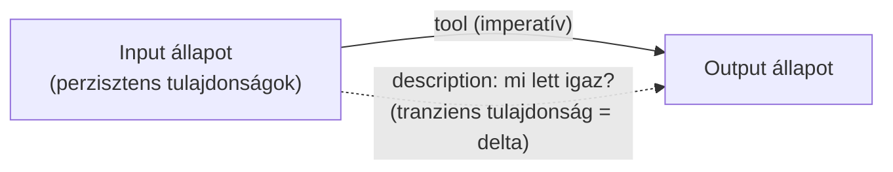

Amit a cellák ebből meg tudnak tanulni (súlyok nélkül, tisztán struktúraként):

| Mit | Példa ARC-ban | InfoCell-ben |
|---|---|---|
| **Invariáns** – mi NEM változik | az alakzat színe és formája ugyanaz marad | `equal(get(in, "shape"), get(out, "shape"))` |
| **Delta** – mi változik és mennyit | eltolás (+2, 0), színcsere kék → piros | egy consequence konkrét értékkel |
| **Reláció** | „a kisebb objektum a nagyobbon belül van” | reláció-cellák az objektumok között |
| **Feltétel** – mikor érvényes | „csak a legnagyobb objektumot tolja el” | a tool előfeltétele / szűrője |
| **Absztrakció** – új tool | „másold 3×” → `repeat(n, axis)` | új tool-kompozíció a könyvtárban |

Az utolsó sor a legfontosabb: ha egy minta több feladatban is előjön, azt érdemes **új tool-ként** elmenteni a saját description-jével együtt. Így a könyvtár (StdLib, ArcLib) a tanulással együtt nő. Ugyanez az ötlete a *DreamCoder*-nek (Ellis és mtsai, 2021, „library learning”), csak ott neurális háló irányítja a keresést.

---

## 2. Mi akadályozza meg, hogy `1 jobbra + 1 balra + 1 jobbra == 1 jobbra`?

A probléma: rengeteg különböző program létezik, de nagyon kevés különböző *hatás*.

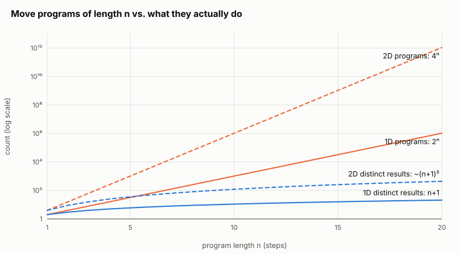

20 lépésnél 1D-ben **~1 millió** program van, de csak **21** különböző eredmény. 2D-ben **~10¹²** program, és csak **~441** eredmény. Ha nem vonjuk össze az azonos hatásúakat, a keresés reménytelen.

Négy eszköz van erre, a legolcsóbbtól a legerősebbig:

1. **Algebrai normálforma.** A mozgások vektorösszeadások, tehát csoportot alkotnak: van asszociativitás, kommutativitás és inverz.
   Ha a `move` tool description-je ezt kimondja, akkor `R + L + R` → `(+1, 0)`.
   Erre már van csíra a kódban: a self-builder (`2 + X == X + 2`) és a `ToolFinder::isConstantFoldingPossible` / `doConstantFolding`.
2. **Megfigyelési (extenzionális) egyenlőség.** Minden jelölt programot lefuttatunk a tanító-inputokon, és az eredményből lenyomatot (hash-t) készítünk.
   Ha egy lenyomat már szerepelt, a hosszabb programot eldobjuk. Ez a leghatékonyabb pruning a példa alapú programszintézisben.
3. **E-gráf / equality saturation** (pl. az *egg* könyvtár). Az egyenértékű formákat egy osztályban tároljuk, a végén pedig kiválasztjuk a legolcsóbbat.
4. **Csökkenő újraírási szabályok.** Minden szabály *rövidít* (`R, L → ε`), ezért a folyamat garantáltan megáll. Ha a szabályok konfluensek is (Knuth–Bendix), akkor az eredmény egyértelmű.

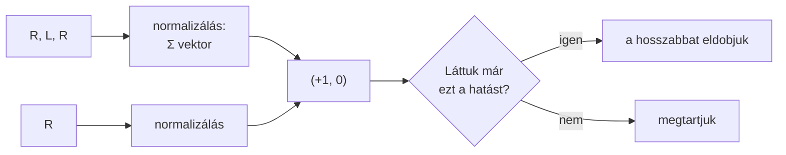

**Gyakorlati javaslat:** a ToolFinder-ben egy jelöltet csak akkor tároljunk el, ha még nem láttuk a hatás-lenyomatát (a tanító-inputokon kapott kimenetek hash-ét). Azonos lenyomatnál a rövidebb nyer.

---

## 3. Színek → általános tulajdonság (enum / diszkrét / folytonos)

Most van 10 fix szín. Ezt érdemes általánosítani egy **Property⟨Domain⟩** cellára, ahol a *domain* nemcsak az értékeket írja le, hanem azt is, hogy **milyen műveletek értelmesek** rajtuk (Stevens-féle mérési skálák):

| Skála | Példa | Értelmes műveletek | ARC példa |
|---|---|---|---|
| **Nominális** (enum) | szín, alakzat-azonosító | `==`, `!=` | a 10 szín |
| **Ordinális** | kicsi < közepes < nagy | + `<`, rang, min/max | „a leggyakoribb szín”, méret szerinti sorrend |
| **Intervallum** | koordináta | + `-` (különbség), eltolás | x, y pozíció |
| **Arány** | darabszám, hossz, terület | + `*`, `/`, arány | pixelszám, „kétszer akkora” |

Néhány következmény:

- **Folytonosból diszkrét:** egy származtatott property küszöbbel vagy binneléssel jön létre (pl. `méret > medián → "nagy"`). Ez a származtatás is egy tool a saját description-jével.
- **Nominálisból ordinális:** az ARC-ban a színek gyakran *szerepet* játszanak, nem színként számítanak. Ilyen a „háttér = leggyakoribb szín” vagy a „kakukktojás = legritkább szín”. A **gyakorisági rang** egy nominális property-ből származtatott ordinális property, és sok feladatot ez old meg.
- **Átnevezés-invariancia:** egy jó szabály nem függ attól, hogy a kék éppen kék-e. Ha a színeket gyakoriság szerint kanonizáljuk (0 = leggyakoribb, ...), akkor ugyanaz a szabály több feladatra is illeszkedik. (A neurális ARC-megoldók ugyanezt színpermutációs augmentációval érik el.)
- Ha egy szabály a Property⟨Domain⟩-re van megírva, és nem a `Color`-ra, akkor **ugyanaz a szabály** működik színre, alakzat-típusra és méret-osztályra is.

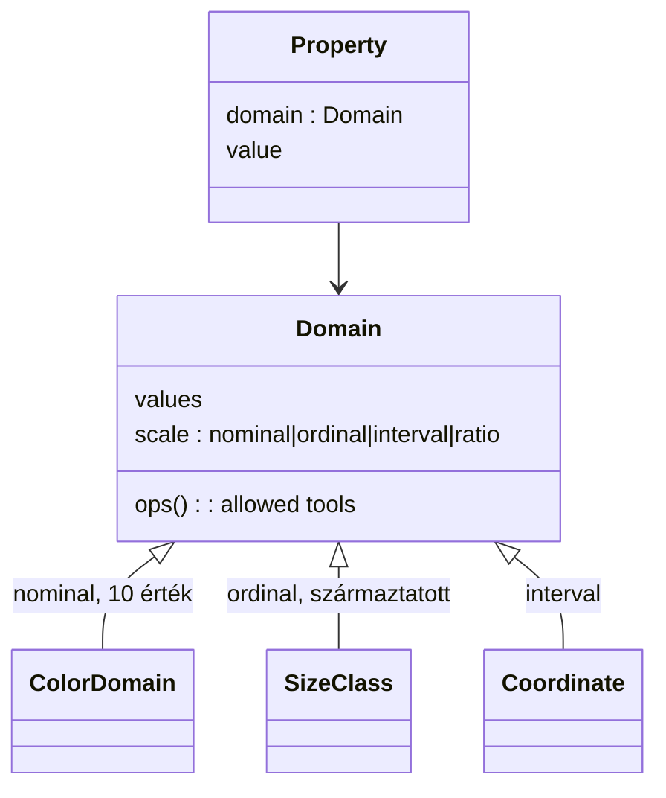

---

## 4. Mire jó ez az ARC-on túl?

A description segment lényegében egy **utófeltétel**: azt mondja meg, mi igaz a művelet után. Ebből több bevált terület is következik:

| Terület | Miért illik ide | Rokon ismert rendszer |
|---|---|---|
| **Példák alapján programozás** (táblázat, szöveg, adattisztítás) | input/output párokból program, mint az ARC-ban | Excel FlashFill |
| **Tervezés, robotika** | a description = a STRIPS „effects”; a ToolFinder egy tervező | STRIPS / PDDL tervezők |
| **Specifikáció és ellenőrzés** | a description = Hoare-hármas utófeltétele / contract | Design by Contract, Dafny |
| **Kódtranszformáció, refaktor** | „ilyen kódból ilyen kód lesz” → szabály | példa alapú refaktor-eszközök |
| **Megmagyarázható döntések** (szabályozott területek) | minden lépés olvasható szabály | szakértői rendszerek, ILP |
| **Tudományos felfedezés** | rövid képletet keres az adatokhoz (MDL!) | AI Feynman, szimbolikus regresszió |

Ahol **nem** erős: a zajos, nagy dimenziós, perceptuális adatok (fotók, hang), mert ott nincs rövid, egzakt program. Ott a neurális hálók jobbak. Valószínűleg a **hibrid** a nyerő: neurális észlelés, ami a pixelekből objektumokat csinál, és erre szimbolikus szabályok.

---

## 5. Az élek InfoCell-referenciák – mit jelent ez?

### 5.1 Lehet KÖR a gráfban?

**Igen, és ez nem hiba, hanem maga az adat.** Ha az élek referenciák, akkor:

- `pixel.up.down == pixel` – két pixel már kört alkot,
- egy alakzat **zárt körvonala** (az EdgeDetector kimenete) definíció szerint kör.

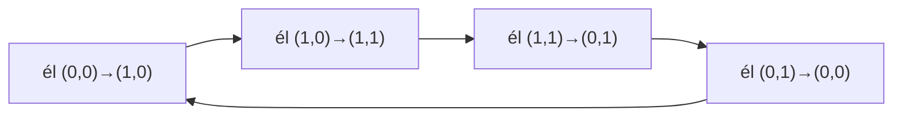

### 5.2 Nem vezet ez a korábbi „folding” problémákhoz?

De, ha naiv a bejárás. Minden rekurzív művelet, ami a referenciákat követi (constant folding, egyenlőségvizsgálat, hash, kiírás, másolás), **végtelen ciklusba** fut egy körön. A megoldások:

| Művelet | Megoldás |
|---|---|
| bejárás, kiírás, másolás | **visited set** (már bejárt cellák), az ismételt cellát referenciaként írjuk ki |
| egyenlőség két ciklikus struktúra között | **biszimuláció**: akkor egyenlők, ha a végtelen kibontásuk egyenlő; ez párok visited-halmazával számolható |
| hash / lenyomat | kanonikus címkézés vagy korlátozott mélység |
| folding / egyszerűsítés | csak a körmentes (DAG) részen. A köröket **SCC-ként** (Tarjan) egy egységnek kezeljük: egy körvonal = egy „kontúr” objektum |

Tipp: érdemes egy **„ownership” fát** és egy **„reference” gráfot** külön tartani. A fa mindig körmentes: a grid birtokolja a pixeleket, a shape birtokolja az éleket, és a folding ezen megy. A szomszédsági és kontúr-referenciák alkotják a ciklikus gráfot, és ezt csak visited set-tel járjuk be.

### 5.3 Determinizmus: két érvényes szabályrendszer – melyik kell?

Ha mindkettő megmagyarázza az összes tanító-párt:

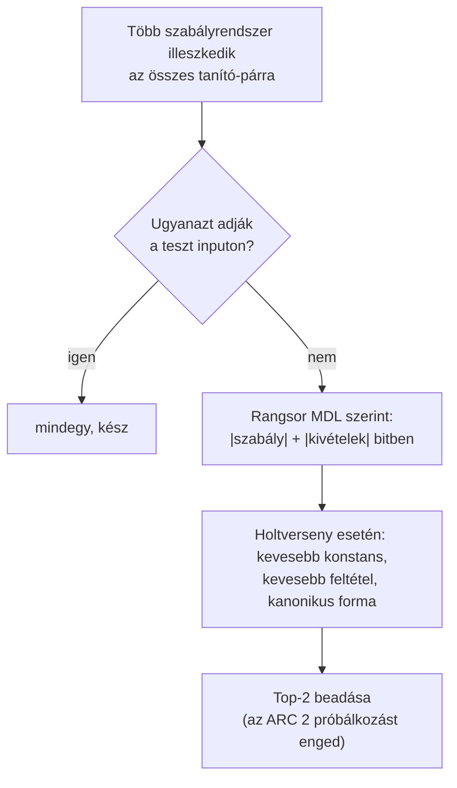

- **„Az egyszerűbbet”** = Occam borotvája, formálisan **MDL** (Minimum Description Length). Lásd a 6. pontot.
- Hogy **determinisztikus** legyen: a rangsor legyen *teljes rendezés*, pl. `(bitméret, konstansok száma, kanonikus forma lexikografikusan)`. Így ugyanarra a bemenetre mindig ugyanaz jön ki, függetlenül a keresés sorrendjétől.

---

## 6. A modellméret ↔ veszteség „logaritmikus” vonal – áttörné ezt?

### 6.1 Mi ez a vonal?

A neurális skálázási törvény (Kaplan és mtsai, 2020): a veszteség hatványfüggvény szerint csökken a modellmérettel, `L(N) = (N_c / N)^0.076`. Log-log skálán ez **egyenes**.

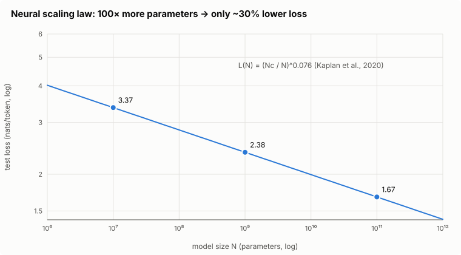

Minden 100× nagyobb modell csak ~30%-kal csökkenti a veszteséget. Ezt a vonalat a jobb architektúrák és adatok csak *eltolják*, letörni nem tudják.

### 6.2 Mi volna a szimbolikus modell „mérete”?

Igen, **a szabályok + a generátor**. Pontosabban egy kétrészes kód (MDL):

```
teljes méret = |generátor / interpreter|      ← konstans: InfoCell VM + StdLib + ArcLib + ToolFinder
             + |tanult szabálykönyvtár|       ← nő a tanulással
             + |az adott feladat programja|   ← feladatonként, ez a "megoldás"
             + |kivételek / maradék|          ← amit a szabály nem magyaráz meg
```

A generátor mérete a Kolmogorov-komplexitás invariancia-tételéből ismert **konstans `c`**: minden nyelvnél más, de feladatonként nem nő.

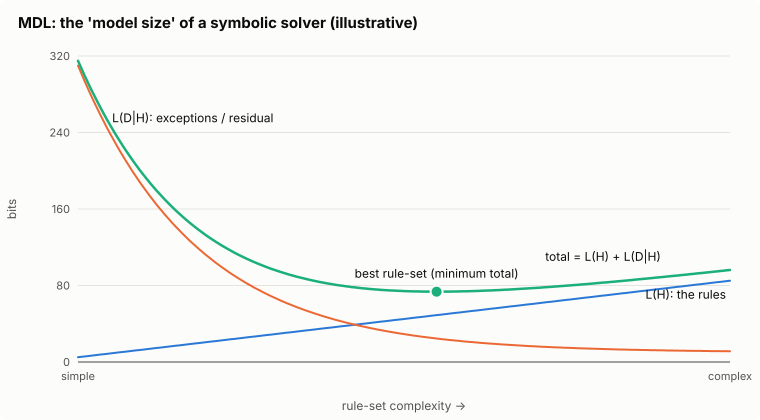

A túl egyszerű szabály sok kivételt hagy, a túl bonyolult szabály túlillesztés. A minimum a jó szabály, és ez egyben az 5.3 pont döntési kritériuma is.

### 6.3 Áttörné-e? Van értelme szimbolikus AI-ra?

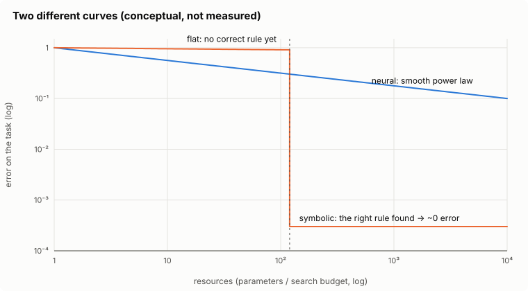

- Ha egy feladatra **létezik rövid, egzakt program** (az ARC ilyen), a szimbolikus rendszer görbéje **lépcső**: amíg nem találja meg a szabályt, nincs javulás; utána a hiba ≈ 0. Ebben az értelemben **igen, áttöri** a hatványgörbét.
- **De a költség átvándorol a keresésbe:** a 2. pont ábrája szerint a keresési tér exponenciálisan nő a program hosszával. A szimbolikus rendszernek is van „skálázási törvénye”, csak az a tengely a *keresési idő*, nem a paraméterszám.
- **Mérhető kísérlet:** az ARC eval feladatain mérd a megoldott % arányát a (a) könyvtár méretének és (b) a keresési költségvetésnek a függvényében, log x-tengelyen. Ez lesz az InfoCell saját skálázási görbéje, és ebből kiderül, hol jobb a neurálisnál.

---

## 7. Compression is intelligence – Kolmogorov, entrópia, ARC

### 7.1 Az alapötlet

- **Kolmogorov-komplexitás `K(x)`:** a legrövidebb program hossza, ami `x`-et kiírja. Nem kiszámítható, de **minden program felső becslést ad rá**.
- **Solomonoff / Hutter:** a legrövidebb magyarázat jósol a legjobban (Hutter Prize: „tömöríts jobban = érts jobban”).
- **MDL** ennek a gyakorlati változata (6.2).

ARC-ra lefordítva: **megoldani egy feladatot = találni egy rövid `p` programot**, amire `p(input_i) = output_i` minden tanító-párra. Ami számít, az a **feltételes komplexitás**: `K(output | input, tanító-párok)` ≈ a szabály hossza.

### 7.2 Mekkora egy ARC-rács maximális entrópiája?

Egy ARC-rács mérete 1×1 és 30×30 között van, 10 színnel. Ha minden lehetséges rács egyformán valószínű:

```
H_max = log₂( Σ_{h=1..30} Σ_{w=1..30} 10^(h·w) ) ≈ 900 · log₂(10) ≈ 2 989.7 bit ≈ 374 bájt
```

(A 30×30-as tag dominál: a következő legnagyobb, 29×30, már 10³⁰-szor kisebb.)

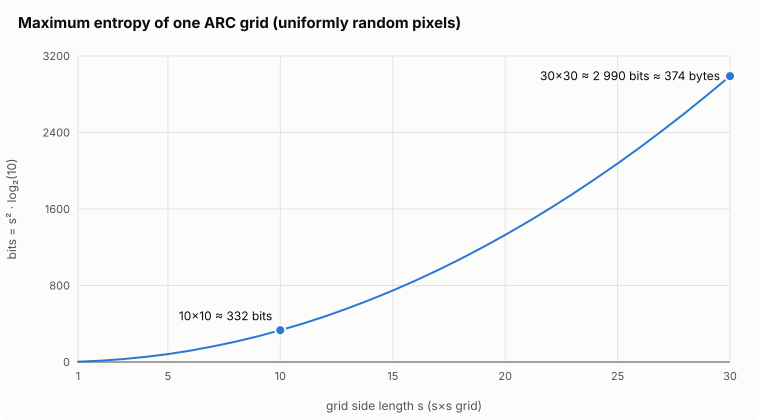

| Mi | Max entrópia |
|---|---|
| 1 pixel | log₂ 10 ≈ 3.32 bit |
| 10×10 rács | ≈ 332 bit |
| 30×30 rács | ≈ 2 990 bit ≈ 374 B |
| egy tipikus feladat (3 tanító-pár + 1 teszt = 8 rács, mind 30×30) | ≈ 23 900 bit ≈ 3 KB |

**A valódi ARC-rácsok ennél nagyságrendekkel kisebb entrópiájúak:** kevés szín, nagy egyszínű foltok, szimmetria, ismétlődés. Pont ezért megoldhatók.

### 7.3 Példa a repóból: `data/line_simple_copy3times.json`

A feladat: a bemeneti sort háromszor egymás mellé másolni.

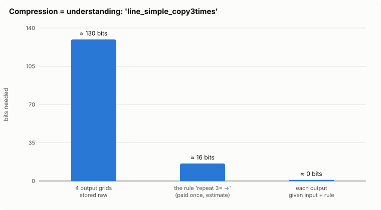

- A 4 kimeneti rács pixelenként tárolva ≈ **130 bit** (39 pixel × 3.32).
- A szabály („repeat 3× vízszintesen”) ≈ **16 bit** (becslés: melyik tool, melyik tengely, hányszor). Ezt **egyszer** kell kifizetni.
- Ha a szabály megvan, minden további kimenet **≈ 0 bit**, mert az inputból kiszámolható.

Ez a „compression is intelligence” lényege: **a szabály megtalálása maga a tömörítés.**

**Mérhető metrika ötlet:** feladatonként vesd össze
1. a rácsok `lzma`-val tömörített méretét (felső becslés az entrópiára),
2. az InfoCell által talált program méretét bitben.

A kettő aránya a megoldó „megértési foka”. Minél kisebb a program a tömörített adathoz képest, annál mélyebb a szabály.

---

## 8. Bele van kódolva az emergencia ebbe a megközelítésbe?

**Röviden: a gyenge emergencia igen, az erős nem. A gyenge is inkább keresésből jön létre, nem dinamikából.**

Két fajta emergenciát érdemes megkülönböztetni:

- **Gyenge emergencia:** a magasabb szintű viselkedést senki nem írta meg explicit módon, de az alacsony szintű szabályokból elvileg levezethető. Ilyen a Game of Life sikló (glider), vagy a hangyaboly útvonala.
- **Erős emergencia:** a magasabb szint olyan dolgot tud, ami az alsó szintből elvileg sem vezethető le. Ez vitatott fogalom, és semmilyen számítógépes rendszer nem tud ilyet, a neurális hálók sem.

### Hol van benne gyenge emergencia?

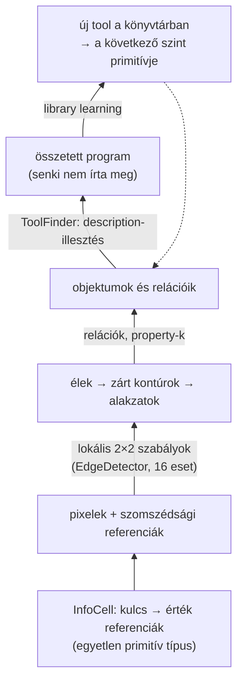

1. **Pixelekből alakzat (alulról felfelé, lokális szabályokkal).** Az EdgeDetector csak 2×2-es pixelkonfigurációkat néz, és ebből zárt kontúrok és alakzatok jönnek létre. Az „alakzat” fogalma sehol nincs pixel-szinten. Ez a klasszikus, celluláris automata típusú emergencia.
2. **Primitívekből program (felülről lefelé, kereséssel).** A ToolFinder egy cél-leírásból (description) rakja össze a programot primitív tool-okból. A kész programot senki nem írta meg, az illesztésből áll elő. Ez emergens *eredmény*, de egy **központi kereső** állítja elő, nem a cellák kölcsönhatása.
3. **Szintek egymásra épülése.** Ha a talált kompozíciók tool-ként visszakerülnek a könyvtárba, akkor a következő feladatnál már primitívként viselkednek (a „hierarchical equations” irány). A szintek így nőnek egymásra, hasonlóan a biológiai rendszerekhez.

### Hol nincs benne?

| Hiányzik | Miért számít |
|---|---|
| **Önszerveződő dinamika:** a cellák nem lépnek lokálisan, párhuzamosan kölcsönhatásba | a valódi emergencia jellemzően sok lokális kölcsönhatásból jön, nem egy központi keresőből |
| **Tanult description-ök:** most az ember írja a tool-ok leírását | a jelentés minden szinten be van tervezve; így amit kapsz, az *kombinatorikus* újdonság, nem *fogalmi* |
| **Szelekciós nyomás:** semmi nem jutalmazza, hogy új szint jöjjön létre | e nélkül nincs ok absztrakciót képezni |

### Hogyan lehetne erősíteni?

- **Tömörítés mint szelekciós nyomás:** egy új szint (absztrakció) akkor „valódi”, ha **rövidebb** leírást ad az alatta lévőnél (MDL, lásd 6–7. pont). Ha a library learning csak a teljes leírást csökkentő tool-okat tartja meg, akkor a szintek a tömörítési nyomásból jönnek létre, nem tervezésből.
- **Lokális aktivitás:** a cellák egy része maga is figyelhetné a szomszédait, és jelezhetne illeszkedést (message passing), a központi ToolFinder helyett vagy mellett.
- **Mérhetővé tenni:** Erik Hoel *causal emergence* mértéke azt méri, hogy a makroszintű leírás több ok-okozati információt hordoz-e, mint a mikroszintű. A tömörítési nézőpont (7. pont) egy egyszerűbb proxy: **mennyi bitet spórol egy szint?**

**Összegezve:** a megközelítés *architektúrája* kifejezetten emergencia-barát, mert minden ugyanabból az egy cellatípusból épül, és szintek épülnek szintekre. Maga az emergencia most két helyen van jelen: az alakzatfelismerésben és a programszintézisben. A következő lépés az lenne, hogy ne csak a programok, hanem a **fogalmak** (description-ök, property-k) is maguktól jöjjenek létre.

---

## Fogalomtár

| Fogalom | Egy mondatban |
|---|---|
| **MDL** | Az a modell a legjobb, amelyikkel a *modell + adat* együtt a legrövidebben leírható. |
| **Kolmogorov-komplexitás** | Egy adat legrövidebb előállító programjának hossza. |
| **Megfigyelési egyenlőség** | Két program akkor egyenlő, ha minden vizsgált bemeneten ugyanazt adja. |
| **E-gráf** | Adatszerkezet, ami egyszerre tárolja egy kifejezés összes egyenértékű formáját. |
| **Biszimuláció** | Ciklikus struktúrák egyenlősége: lépésenként ugyanúgy viselkednek. |
| **SCC** | Erősen összefüggő komponens: egy gráf olyan része, ahol bárhonnan bárhová el lehet jutni (= a körök). |
| **Skálázási törvény** | A neurális modellek vesztesége hatványfüggvény szerint csökken a mérettel. |
| **STRIPS** | Klasszikus tervező formalizmus: előfeltételek + hatások. |
| **Gyenge / erős emergencia** | Gyenge: az alsó szintből levezethető, de nem explicit megírt viselkedés. Erős: elvileg sem levezethető. |
